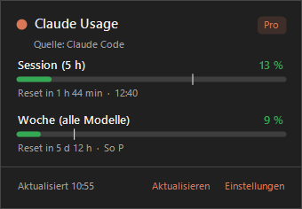
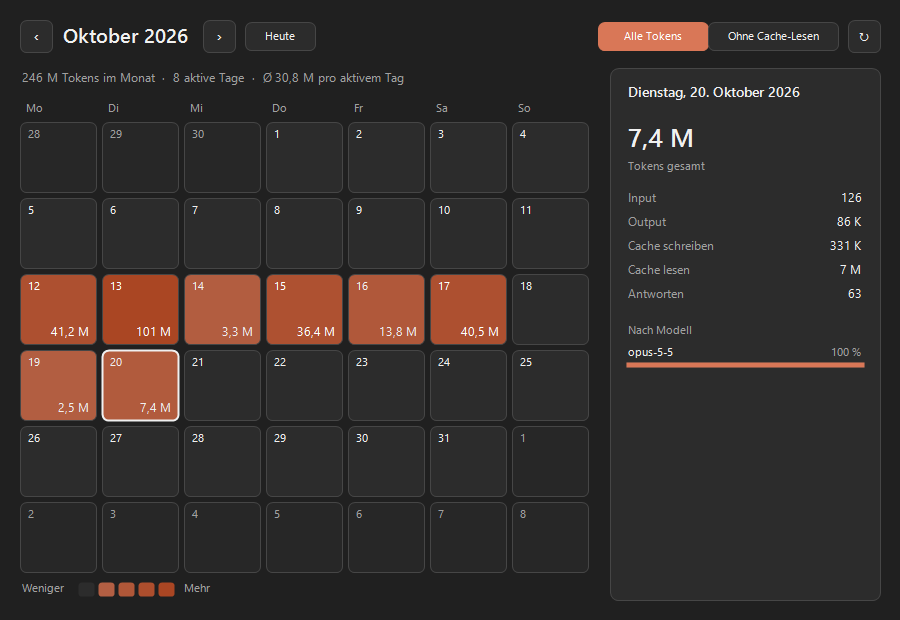

# Claude Usage Tracker – Windows

Windows tray port of [hamed-elfayome/Claude-Usage-Tracker](https://github.com/hamed-elfayome/Claude-Usage-Tracker) (macOS, MIT; see `LICENSE-original.txt`).





## Features
- Tray icon showing the current percentage (session, week or highest value), colored with the original's pace-aware logic
- Popup (left click): 5-hour session, weekly limit, per-model limits (Opus/Sonnet/Fable/Design), reset countdowns, pace marker, extra usage
- Data source **Claude Code login** (`%USERPROFILE%\.claude\.credentials.json`, automatic token refresh with write-back) or a **claude.ai session key** (stored encrypted with DPAPI)
- Notifications when thresholds are reached and when the session resets
- Start with Windows (HKCU `Run`), light/dark theme following the taskbar, German/English UI
- **Token calendar** (tray menu, popup → "Kalender", or `ClaudeUsageTracker.exe --calendar`): monthly heatmap of tokens per day from local Claude Code transcripts (`~\.claude\projects\**\*.jsonl`), per-day breakdown (input/output/cache, models), toggle to exclude cache reads. Keys: arrows = day, PgUp/PgDn = month, F5 = rescan
- `ClaudeUsageTracker.exe --once` prints the usage to the console

## Build
Needs no SDK; it uses the `csc.exe` that ships with Windows (.NET Framework 4.x):

```powershell
powershell -ExecutionPolicy Bypass -File build.ps1
```

Output: `bin\ClaudeUsageTracker.exe` (standalone, ~60 KB).

## Not ported (macOS-specific or out of scope)
Notch HUD / Dynamic Island, multiple profiles, Codex provider, statusline installer, terminal launchers, Sparkle updates.
